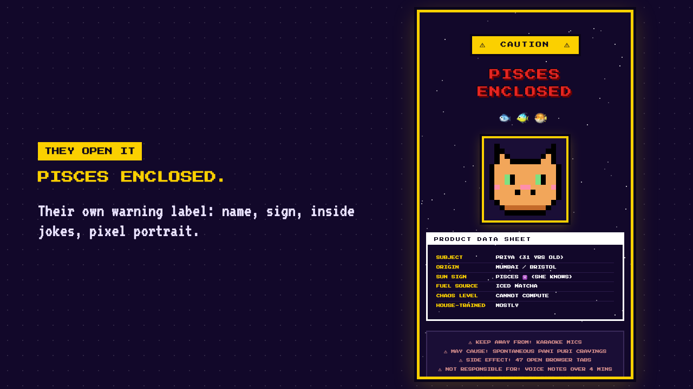
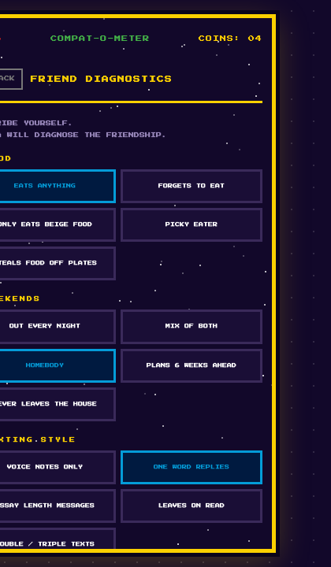
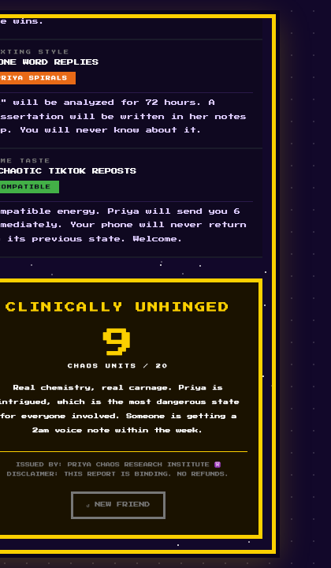
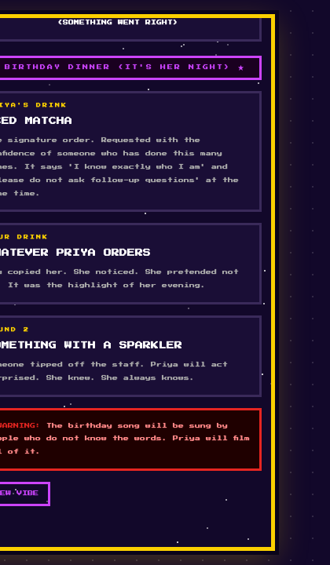

# Birthday Roast

Turn someone you love into a retro 8-bit warning label.

You fill in a short form (name, sign, pronouns, a few inside jokes) and get a link to a pixel-art birthday card with four mini-games, all about them. No sign-up and no backend.

[](docs/how-it-works.mp4)

▶ **[Watch the 50-second walkthrough](docs/how-it-works.mp4)** · **[Make a card](https://uyxh20.github.io/birthday-roast/)** · **[See the demo card](https://uyxh20.github.io/birthday-roast/card.html)**

## What the birthday person gets

| Dashboard | A diagnosis | Drinks oracle |
|---|---|---|
|  |  |  |

- **A warning label**: their name, star sign, pixel portrait and inside jokes, presented as a product data sheet.
- **Four mini-games**: a compatibility diagnosis, a 5-question quiz, an excuse generator and a drinks oracle.
- **Two joke packs**: *Dating chaos* (the original, for friends who will laugh) and *Life chaos* (safe for family and coworkers).

## How it works

1. **Fill in** their name, age, birthday (the star sign sets itself), pronouns and four inside jokes.
2. **Preview** the card live as you type. Every one of the ~240 lines can be rewritten.
3. **Send** the link, or download the card as a single HTML file that works offline.

## Under the hood

- **The card lives in the link.** The config is JSON, deflate-compressed with the browser's `CompressionStream`, base64url-encoded, and stored after the `#`. The part after `#` is never sent to a server, so nothing is stored anywhere. A typical link is about 400 characters.
- **Photos never leave the browser.** An upload is centre-cropped, shrunk and reduced to 16 colours with k-means, giving a 32×32 sprite of about 1 KB that fits in the link.
- **Jokes are templates.** Lines like `{They} know{s}` render as "He knows" or "They know". A tag's case sets the output's case (`{name}`, `{Name}`, `{NAME}`).
- **Links are untrusted input.** Anyone can hand-craft a link, so every field is validated and every string is HTML-escaped before rendering.
- **Download = one file.** The maker inlines the CSS and scripts and injects the config, so the card keeps working without this site.
- **No build step, no dependencies.** Plain HTML, CSS and JavaScript.

## Project map

```
index.html        the maker: form, live preview, send / download
card.html         the card player: reads a config, renders the games
src/
  packs.js        all the jokes (two packs), star signs, pronoun sets
  engine.js       config validation, templating, card rendering and game logic
  codec.js        config <-> link encoding
  demo.js         preset pixel avatars and the demo friend, Mochi
  pixelate.js     photo -> 32x32 sprite (maker only)
  maker.js        maker UI wiring
  card.css        the card's look; maker.css: the maker's look
tests/            node:test regression tests (no dependencies)
docs/             README media
```

## Run it locally

```bash
python3 -m http.server 8000
```

Then open <http://localhost:8000>. Tests need Node 18 or newer:

```bash
node --test
```

## Make your own pack

Copy one of the packs in `src/packs.js`, keep the same shape (4 traits, 5 questions, 6 crimes, 6 vibes), rewrite the lines and register it in `window.ROAST_PACKS`. The tests check that every line fills in for every pronoun set.

## Why this exists

It started as a one-off birthday gift: a single hand-written page full of inside jokes for one very specific Pisces. This repo turns that page into a template, so anyone can make one for their own people.

## License

[MIT](LICENSE)
